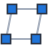

# Banian Stretch

Stretch geometry in SketchUp with Move mechanics, **straight through nested groups and components**.
Whatever is inside the selection moves. Whatever is outside stays put. Parts that cross the boundary are stretched.

<div dir="rtl">

## معرفی (فارسی)

بانیان استرچ قسمتی از مدل را می‌کشد، بدون اینکه گروه‌ها و کامپوننت‌ها جلویش را بگیرند.

**کاربرد معمول:** یک کابینت یا مبل که از چند گروه تو در تو ساخته شده را ۲۰ سانت پهن‌تر کنید، بدون اینکه ضخامت ورق‌ها یا اندازه‌ی دستگیره‌ها تغییر کند.

### ابزارها

| آیکون | ابزار | کار |
|---|---|---|
|  | **Stretch (Window / Click)** | یا کادر بکشید، یا روی یک لبه یا وجه کلیک کنید. بعد نقطه‌ی شروع و پایان را بزنید. |
|  | **Stretch by Box Bounds** | یک مستطیل بکشید و ارتفاع محدوده (Bound Height) را بدهید. هرچه داخل جعبه باشد کشیده می‌شود. با `Tab` مستطیل چرخیده رسم می‌شود. |
|  | **Stretch by Face Bounds** | روی یک وجه کلیک کنید. هرچه تا فاصله‌ی Bound Height از آن وجه باشد کشیده می‌شود. |

### تاگل‌ها

| آیکون | تاگل | توضیح |
|---|---|---|
|  | Groups & Components | گروه یا کامپوننتی که کامل داخل محدوده است، بدون تغییر شکل جابه‌جا می‌شود. |
|  | Faces | وجه‌هایی که همه‌ی رأس‌هایشان داخل محدوده است. |
|  | Edges | لبه‌هایی که هر دو سرشان داخل محدوده است. |
|  | Vertices | هر رأسی که داخل محدوده باشد (فراگیرترین حالت). |
|  | Make Unique | **روشن:** کامپوننت‌های مشترکی که ویرایش می‌شوند تعریف مستقل می‌گیرند. **خاموش:** این کامپوننت‌ها قرمز نمایش داده می‌شوند و همه‌ی نسخه‌ها تغییر می‌کنند. |

### کلیدها

- **Ctrl** (در مک **Option**) همراه کلیک یا کادر: اضافه کردن به انتخاب
- **Shift** همراه کلیک یا کادر: کم کردن از انتخاب
- **فلش‌های ← → ↑**: قفل کشش روی محور سبز، قرمز یا آبی. **↓** قفل را برمی‌دارد.
- **Shift** حین کشش: قفل کردن جهت فعلی (inference)
- **تایپ عدد** در کادر اندازه: فاصله‌ی دقیق. عدد منفی جهت را برعکس می‌کند.
- **Esc**: یک مرحله به عقب
- **پیش‌انتخاب**: اگر قبل از فعال کردن ابزار چیزی انتخاب کنید، کشش فقط روی همان اثر می‌گذارد (کادر خط‌چین سبز).

کل کشش با یک بار **Undo** برمی‌گردد.

### زبان

- پنجره‌ی تنظیمات و منوها دو زبانه‌اند (فارسی و انگلیسی).
- توضیح آیکون‌های تولبار (tooltip) و متن نوار وضعیت همیشه انگلیسی است.
- زبان منوها بعد از باز و بسته کردن اسکچ‌آپ عوض می‌شود.

### نصب

1. فایل `dist/banian_stretch_v1.0.1.rbz` را دانلود کنید.
2. در اسکچ‌آپ این مسیر را باز کنید: **Extensions → Extension Manager → Install Extension**.
3. فایل را انتخاب کنید.
4. تولبار **Banian Stretch** را از **View → Toolbars** روشن کنید.

### اگر کار نکرد

- اگر خطایی رخ دهد، یک پیام با متن خطا نشان داده می‌شود و جزئیات در یک فایل لاگ ذخیره می‌شود. مسیر فایل داخل همان پیام آمده است.
- از منوی **Extensions → بانیان استرچ → گزارش مشکل (Diagnostics)** نسخه‌ها، تنظیمات و مسیر لاگ را ببینید و برای ما بفرستید.
- کادر انتخاب باید **رأس‌ها** (گوشه‌ها و سرهای قطعه) را دربر بگیرد. اگر کادر فقط از وسط یک وجه رد شود، چیزی انتخاب نمی‌شود و پیامی در نوار وضعیت نشان داده می‌شود.
- اگر تاگل‌های فیلتر خاموش باشند، چیزی انتخاب نمی‌شود.

اکستنشن هنوز امضا (sign) نشده است. اگر اسکچ‌آپ اجازه‌ی نصب نداد، در Extension Manager بخش **Loading Policy** را روی **Approve Unidentified Extensions** بگذارید.

</div>

## English

### Installation

1. Download `dist/banian_stretch_v1.0.1.rbz`.
2. In SketchUp, open **Extensions → Extension Manager → Install Extension** and choose the file.
3. Turn on the **Banian Stretch** toolbar from **View → Toolbars**.

The extension is not signed yet. If SketchUp blocks it, set the Extension Manager **Loading Policy** to *Approve Unidentified Extensions*.

**Compatibility.** Targets the current SketchUp Ruby API (Ruby 3.2, SketchUp 2024–2026) and is written for SketchUp 2027 once it ships. It uses no APIs newer than SketchUp 2021.

### How it works

For every entity in the active editing context, and recursively inside groups and components:

| Situation | Result |
|---|---|
| Group or component **completely inside** the selection | moved as a whole, not deformed (`Groups & Components` filter) |
| Group or component **partly inside** | entered; only its inner vertices, edges and faces inside the selection move |
| Loose geometry | the selected vertices move, so the connected edges and faces stretch |

**Make Unique**
- Groups are always made unique when they are edited, as SketchUp itself does.
- Shared components are made unique only when **Make Unique** is on.
- When it is off, every copy of an edited component changes, and the preview draws those components in red.

**Undo**
- The whole stretch is one undo step.
- If the operation fails, it is aborted so the model is left untouched.

### Project layout

```
banian_stretch/
  src/banian_stretch.rb            extension loader (registers the extension)
  src/banian_stretch/
    main.rb                        loads everything, builds toolbar + menu
    settings.rb, i18n.rb           preferences, EN/FA strings
    region.rb                      ScreenRegion (window) and BoxRegion (oriented box)
    plan.rb                        selection plan: walks nested instances, keys, preview data
    applier.rb                     executes the stretch (make unique, local vectors, one undo step)
    tools/                         SelectTool, BoxTool, FaceTool and their shared BaseTool
    dialog.rb, html/settings.html  Settings & Help window (English / Persian)
    icons/                         SVG (Windows), PDF (macOS), PNG fallback
  tests/                           offline tests with a mocked SketchUp API
  tools/build_rbz.py               builds dist/banian_stretch_v<version>.rbz
  tools/render_icons.js            renders the SVG icons to PDF/PNG
```

### Development

```bash
ruby banian_stretch/tests/test_core.rb
```

```bash
ruby -Ibanian_stretch/tests/stub_lib banian_stretch/tests/test_tools.rb
```

```bash
python3 banian_stretch/tools/build_rbz.py
```

The tests run against a mocked SketchUp API. They cover the stretch logic (nested, rotated and scaled instances, Make Unique, filters, preselection) and drive the tools with simulated mouse and keyboard input. They do not replace testing inside SketchUp itself.
